<!-- 柊東雲 · the three pictures are built by tools/build_assets.py -->

  <picture>
    <source media="(prefers-color-scheme: dark)" srcset="assets/cover-dark.svg">
    <source media="(prefers-color-scheme: light)" srcset="assets/cover-light.svg">
    
  </picture>

  <picture>
    <source media="(prefers-color-scheme: dark)" srcset="assets/motto-dark.svg">
    <source media="(prefers-color-scheme: light)" srcset="assets/motto-light.svg">
    
  </picture>

  <picture>
    <source media="(prefers-color-scheme: dark)" srcset="assets/medallion-dark.svg">
    <source media="(prefers-color-scheme: light)" srcset="assets/medallion-light.svg">
    
  </picture>

